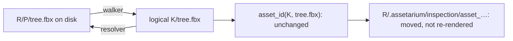

# ASSETRM-0002 plan: Asset sources rework

Implementation handoff for [ASSETRM-0002](ASSETRM-0002.md). The owner settled the decisions
below on October 30, 2026. An agent that picks this up still runs the **`AGENTS.md`
scope-and-plan checkpoint once per phase** (duration, disk, risks) before editing code, and
reads the [Sources and Catalog hub](../../Sources%20and%20Catalog/Sources%20and%20Catalog.md),
[Sources](../../Sources%20and%20Catalog/Sources.md), [decision 0019](../../../Decisions/0019-source-folders-and-export-variants.md)
and the [Catalog contract](../../../Architecture/Sources%20and%20Catalog/Catalog%20contract.md) first.

## 1. Owner decisions (2026-10-30)

| # | Topic | Decision |
| --- | --- | --- |
| D1 | Where generated data lives | Keep it **inside each source**, in a hidden folder renamed from `metadata-lal/` to **`.assetarium/`** (on Windows, also set the hidden attribute). |
| D2 | Old nested metadata folders | The migration **merges** them into a parent root the owner names. |
| D3 | Adding a folder that contains existing sources | **Absorb** the contained sources into the new root. |
| D4 | How absorbed results survive | **Pack anchors**: absorbed assets keep their asset IDs and every result. Nothing is reprocessed. |
| D5 | Asset types | A source always includes **every supported type**. Per-source `import_types` and `import_formats` are removed. The global processing-format checkboxes only set the **default selection** in the processing picker. |
| D6 | Excluded folders | Kept (decision 0019 behavior unchanged). |
| D7 | Processing scope | **Start processing…** opens **one multi-root picker** covering all sources. The checked items run as one queued run, source by source, one GPU job at a time. |
| D8 | Descriptions | The same picker has an **"Also generate descriptions"** toggle, shown only when the descriptions feature is on. |
| D9 | Unchecked items | The picker is per run and saves nothing. Unchecked work **stays visibly pending**; to never process something, the user excludes it. |
| D10 | Migration targets | The migration script takes the merge roots as arguments (`--root`, repeatable). It shows a dry-run report by default and asks for an interactive confirmation before applying. Any old folder under no named root is converted in place. |
| D11 | Estimate | The picker shows **counts per stage, an estimated time range and projected disk use**, and says "no measurement yet" when it cannot estimate. |
| D12 | Tree rows | A compact **icon strip** with tooltips (§5.3). |
| D13 | Navigation | A new **Asset sources** rail item with a folder icon, placed **above Settings** in the bottom group. **Settings → Asset sources is removed.** |
| D14 | Moved sources | The migration also **repairs sources whose folders moved** (for example the owner's move from drive C to drive D), and the app gets a **Locate folder…** action for a source whose folder is missing (§4.1, §5.5). |
| D15 | One name in code | **No hardcoded `metadata-lal` remains** in the project: one constant, a legacy constant for reading and migrating, and a test that enforces it (§3.5). |

D1–D4, D14 and D15 are recorded in [decision 0023](../../../Decisions/0023-assetarium-metadata-folder.md).

Binding decisions that stay: originals are read only (only the source's own `.assetarium/` is
written); scans never run models; processing never starts automatically; faults stay visible,
keep their evidence and are never retried automatically; changing settings never deletes results.

## 2. Why the in-source folder stays (brainstorm record)

The central registry `data/library/sources.json` already identifies a source by its path. The
in-source folder is not needed for *recognition*. It is kept because it gives three things a
central store cannot:

1. **Identity that survives moves.** The KayKit pack moved from one drive to another and kept
   every result. Records store logical `data/...` paths (`sources.generated_path`), and the
   absolute paths inside inspection `job.json` files are stale evidence that nothing reads.
2. **Portability.** A processed pack (or an external drive) carries its previews and
   descriptions to another install or developer.
3. **Removing and re-adding is lossless.** Removing a source keeps the folder, and re-adding the
   folder recovers everything.

Accepted costs: Assetarium writes into the asset folders, and read-only media cannot be a source.
A dot-folder is skipped by Godot and Unity imports and hidden by default on Linux. Cloud-synced
folders will sync hundreds of MiB of previews (KayKit's folder is ~716 MiB and ~12k files). The
Add-folder flow should **warn** when a path is inside a known sync root (OneDrive, Dropbox, Google
Drive; detect by path and environment variables, never by guessing). Rejected options: a hybrid
(identity in the source, results central) and central-only storage. Both lose portability and
need a multi-GB move.

**Migration finding:** renaming the folder is enough for the data itself. No record needs
rewriting, and the `metadata-lal` strings inside `job.json`, batch files and `jobs.sqlite` are
evidence that stays untouched.

## 3. Target model

### 3.1 `.assetarium/` and `source.json` schema 2

The folder keeps today's internal layout (`captions/`, `inspection/`, `library/`…). Changes:

```jsonc
// <source>/.assetarium/source.json
{
  "schema_version": 2,
  "id": "<32 hex>", "key": "<source key>",
  "excluded_folders": [...], "export_decisions": [...], "texture_folder": {...},  // unchanged meaning
  "anchors": [                       // D4, §3.2; empty for an ordinary source
    {"id": "<old source id>", "key": "<old key = logical prefix>", "path": "<subfolder relative to root, POSIX>",
     "excluded_folders": [...], "export_decisions": [...], "texture_folder": {...},
     "absorbed_utc": "...", "evidence": "absorbed/<old id>/"}
  ],
  "migrated_from": {"schema_version": 1, "folder": "metadata-lal", "utc": "...", "receipt": "..."}  // optional
}
```

- `import_types` and `import_formats` are gone (D5). When `sources.import_types` /
  `sources.import_formats` read a schema 1 file, they return "everything", so an unmigrated folder
  behaves like the new model. Its other faults are still reported (§3.4).
- Name constants and the removal of every hardcoded `metadata-lal`: see §3.5.
- On Windows, set `FILE_ATTRIBUTE_HIDDEN` on `.assetarium` when it is created or migrated
  (`ctypes` `SetFileAttributesW`). A failure to set it is a recorded warning, never a fault.

### 3.2 Pack anchors: absorbing without changing asset IDs

`catalog.asset_id(pack, identity)` hashes the **source key** (the pack: the first segment of a
record path) and the path inside it. The inspection fingerprint (`incremental.inspection_input`)
includes the record's `asset_id`, `pack_id` and file `path`s. So changing a source's root would
change every ID and fingerprint. That would orphan the previews, descriptions, collections and
owner overlays, and re-queue every render.

**Design: an anchor is a logical prefix mapped to a physical subfolder.** If the parent root
`R` (key `Q`) absorbs a child at `R/P` (key `K`), files under `R/P` keep their **logical paths
`K/…`**. They do not become `Q/P/…`. Because logical paths are unchanged, `pack_id`,
`source_relative_identity`, `asset_id`, the file paths in records and every fingerprint stay
byte-identical. Only path resolution changes:

- `catalog.walk_source` emits `K/<path relative to R/P>` for files under an anchor, and
  `Q/<path relative to R>` for everything else. The parent's own excludes never reach inside an
  anchor unless they name it. Inside an anchor, the anchor's own `excluded_folders`,
  `export_decisions` and `texture_folder` apply, because they were written relative to the child's
  root.
- A single resolver maps a logical path to disk: `K/x` → `R/P/x` and `Q/x` → `R/x`. Today
  `sources.source_for_path` splits the key from the first segment, and every disk access must go
  through the resolver. **Audit every `split('/')[0]`, `relative.parts[0] != pack`
  (`asset_structure.new_record`) and `source_root /` join**, plus dependency and texture
  resolution (`dependency_resolution`, `texture_folders`, `texture_repair`). A dependency may cross
  from an anchor into the parent's folders, and that must resolve.
- `sources.owners` and `generated_path` map an asset to its registered source. Absorbed asset IDs
  now map to `R`, so their results resolve to `R/.assetarium`.
- Anchors nest: absorbing a root that has its own anchors lifts those anchors into the new root,
  with their paths composed.
- Collisions are refused, never guessed: an anchor key equal to the root key, to another anchor
  or to a registered or detached source key, and overlapping anchor paths.
- Search vectors may rebuild if their source fingerprint covers the root's file list. That is
  cheap and acceptable. Previews, inspections and descriptions must not re-queue (§7 test).

UI and display names stay physical. The tree shows real folders, and an anchor is just a folder
with a small "merged source" tooltip.



### 3.3 Absorb operation (shared by the app and the migration)

`sources.absorb(config, root, children)` runs under the `source-settings` lease, refuses while any
involved source has an active operation, and is journaled so a crash can resume
(`R/.assetarium/migration/journal.json`):

1. Make sure `R/.assetarium` exists with an identity. If `R` itself has a legacy folder, convert
   it first (§4).
2. For each child, deepest first: move each per-asset result directory (`inspection/asset_*`,
   `captions/asset_*` and every other per-asset tree in the child's metadata) into
   `R/.assetarium/` **by rename**. Everything is on the same volume, because links and junctions
   are rejected. **If an asset ID already exists in `R`, stop that child and record the fault;
   never overwrite.**
3. Merge the child's stage-ledger rows (`library/jobs.sqlite` `jobs` and `history`) into `R`'s
   ledger. Move everything else (generations, batches, operations, logs, `source.json`) into
   `R/.assetarium/absorbed/<child id>/` as evidence (decision 0006 retention). Remove the emptied
   child metadata directory with a plain `rmdir`, which only succeeds when the directory is empty.
4. Write the anchor entry. In the registry, register `R`, drop the children from `sources` and
   `detached`, and record them in the anchor.
5. Rescan `R`. A scan runs no models. **Verify that every asset ID the children had published is
   still present in `R`**, and record any that is missing as a visible fault. Do not repair it.

### 3.4 Asset state taxonomy (fixes the known ASSETRM-0002 problems)

Each asset has exactly one **work state** and a few **overlays**. This splits "can be resolved by
processing" from "cannot":

| Work state | Meaning | Action offered |
| --- | --- | --- |
| `processed` | Every applicable stage is complete and published | none |
| `pending` | Runnable work exists | Process… |
| `blocked` | Work exists but a prerequisite is missing (search runtime not installed, Blender missing, description engine not set up) | The fix ("Install search runtime", "Set up Blender"…), **never Process** |
| `failed` | Recorded fault (evidence kept) | Copy error · Recheck (decision 0020, explicit) |
| `excluded` | Inside an excluded folder | Include again |
| (non-asset) | Not a recognized asset (README, HTML…) | none |

Overlays: `warning` (caption warnings and the `review_note`/`warning` findings from
[Caption severity](../../../Architecture/Processing/Caption%20severity.md); only `warning` is shown
as ⚠), `description` (complete / missing / failed; shown only when descriptions are on),
`collections` (count). Derive the state from the existing `sources.import_outcome` /
`processing_summary` / `description_state` rather than building a parallel model.
`processing_summary` gains a `blocked` count with reasons. The Kenney case (previews done, search
stage cannot run) becomes `blocked: search runtime not installed` instead of a Process action that
always fails.

With D5, `pending` counts **every** unprocessed asset, whatever its format. The global format
checkboxes keep two roles only: they set the picker's default selection, and they set the format
preference `incremental.choose_source` uses to pick which file of a grouped asset is rendered. The
"Processing paused: no formats selected" state goes away. With nothing checked by default, the
picker simply opens empty.

### 3.5 Removing every hardcoded `metadata-lal` (D15)

Introduce `METADATA_DIR = ".assetarium"` and `LEGACY_METADATA_DIR = "metadata-lal"` once (in
`sources.py`, or `config.py` if `config` must not import `sources`), plus a
`RESERVED_METADATA_DIRS` pair. `validate_exclusion`, `validate_directory`, `add`, `bound`,
`generated_path`, `config` (logical path checks) and `catalog.walk_source` treat both names as
reserved and never walk either one.

Every tracked occurrence of the literal (counted with `git grep -c metadata-lal` on 2026-10-30),
and what happens to it:

| Where | Occurrences | Change |
| --- | --- | --- |
| `src/local_asset_library/sources.py` (12), `config.py`, `catalog.py`, `retrieval.py` (docstring), `owner_commands.py` (storage budget text), `source_migration.py` | 18 | Use the constants. UI and CLI text says "each source's `.assetarium` folder". `source_migration.py` (the October 14 one-time move, which refuses reruns) checks both names through the constant. |
| `src/local_asset_library/blender_worker.py` | 2 | **Special case, see below.** |
| `frontend/src/app/format.ts` (storage budget help) | 1 | New wording, then `npm run build`. The literal also leaves `ui/build/`. |
| `tests/` (`test_sources.py` 5, `test_settings.py` 2, `test_sources_blender.py`, `test_source_exports.py`, `test_processing_formats.py`, `test_images.py`, `test_cpu_embedder.py`) | 12 | Use the constant. Add tests for the legacy name: it is reserved, read-only and reported as needing migration. |
| `scripts/verify-*.py` (texture-folders 2, source-folders 2, show-in-explorer, notifications, image-browser, collections), `scripts/smoke-headless.py` | 9 | Import the constant. |
| `scripts/historical/kaykit-gltf-maintenance.py` | 1 | Frozen one-time script that refuses reruns: **leave it**, allowlisted. |
| `.gitignore` | 1 | `.assetarium/` added. Keep `metadata-lal/` so unmigrated fixtures never get committed (allowlisted). |
| `README.md`, `CLAUDE.md`, `docs/asset-sources.md` (4), `docs/dependency-path-overrides.md` | 7 | Say `.assetarium`. Mention the migration in `docs/asset-sources.md`. |
| Vault: Sources (5), Sources and Catalog, Stage ledger and fingerprints (2), Storage discipline, `_Templates/System Note.md`, Catalog contract, Embedding contract, Expansion plan, Library updates, decisions 0006 and 0019 | 15 | Say `.assetarium`. Decisions 0006 and 0019 get a "folder renamed by [0023]" note; their rules are unchanged. |
| `docs/history/progress-2026-10.md` (4), ASSETRM notes, decision 0023, CHANGELOG migration entry | — | Frozen or historical: **keep**, allowlisted. |

**The Blender worker** builds `output_root = source_root / "metadata-lal"` and rejects relative
paths that contain the name. The worker's hash is part of every inspection fingerprint, so any edit
re-queues every inspection unless it is proven equivalent ([decision 0022](../../../Decisions/0022-parallel-rendering.md)).
Edit it **once** so it never names the folder again:
- The output root comes from the job's existing `metadata_root`. That value must be a direct child
  of `source_root`, and its name must be in a `reserved_metadata` list the job also carries.
- The relative-path check uses that list.
- Then register the new hash (LF and CRLF) in `incremental.EQUIVALENT_WORKERS`, proven with
  `scripts/check-render-stability.py`, which shows identical CPU renders.
The batch worker and the repair workers do not contain the literal. Confirm that again when
implementing.

**Enforcement:** a test (`tests/test_metadata_name.py`) runs `git ls-files` and fails if any
tracked text file outside an explicit allowlist (the constant's definition, the migration script,
`scripts/historical/`, `docs/history/`, `.gitignore`, `CHANGELOG.md`, decision 0023 and the
ASSETRM-0002 notes) contains `metadata-lal`. Skip `ui/vendor/` and the hash-bound `docs/mcp/*.json`
(none contain it today). The check also covers `src/local_asset_library/ui/build/`.

## 4. One-time migration script

`scripts/migrate-metadata-folders.py`, run with the base runtime (`.\scripts\uv.ps1 run --locked
python scripts/migrate-metadata-folders.py …`, same arguments under `uv.sh` on Linux). It is for
every existing install, not just the owner's library, so it stays out of `scripts/historical/`
until a release no longer supports schema 1. Model it on `source_migration.py` and
`scripts/historical/kaykit-gltf-maintenance.py`: refuse links, out-of-root targets and reruns, and
work from a manifest.

```
migrate-metadata-folders.py [--root PATH ...] [--search PATH ...] [--apply]
```

`--root` names a folder that becomes one source and absorbs every old folder under it. `--search`
only adds a place to look (for example the drive a pack moved to). Nothing under a search folder is
absorbed.

1. **Preflight (read only).** The app and MCP server are not running (the existing leases and
   locks), no source operation is active, and a storage receipt is saved before applying
   (`scripts/storage-report.py --output <new>.json`).
2. **Discover.** Deep-search every registered and detached source path that exists, every
   `--root` and every `--search` for directories named `metadata-lal`, at any depth, without
   following links or junctions (count them and report them). Validate each one: a regular
   directory, `source.json` schema 1 valid, and no sibling `.assetarium` (if one exists, report a
   conflict and skip).
3. **Relink moved sources (D14, §4.1).** Match the found folders to the registry by identity
   (`source.json` `id`), never by name. When a registered or detached entry's `path` differs from
   the one folder carrying its `id`, the plan relinks the entry to that folder; this covers the
   C → D move. Two folders with the same `id` (a copied pack) are a conflict: report both and
   relink neither. A missing entry that no found folder matches is reported with "pass the folder
   that now contains it with `--search`". Relinking happens before any absorb.
4. **Plan.** Group the found folders: those under a `--root` are absorbed into it (§3.3). Each
   top-most folder under no root is converted in place, and a folder nested inside another found
   folder outside any root is absorbed by its nearest found ancestor. Per folder, report the asset
   counts and what D5 does to it:
   - `import_types` without `image`: N images will enroll as **pending** at the next scan.
   - `import_formats` (KayKit: `["gltf"]`): **propose exclusion patterns** for folders whose
     recognized files are all of a dropped format (for example KayKit's `fbx/`, `obj/` export
     trees). Files of dropped formats in mixed folders cannot be excluded by folder; list them as
     "will enroll as pending". Proposed exclusions are applied only on confirmation.
   Write the plan as JSON to `data/library/metadata-migration/plan-<utc>.json`. Without
   `--apply`, stop here (dry run).
5. **Apply.** Interactive confirmation only (type `yes`; no `--yes` bypass, per the owner-only rule
   for state-changing owner commands). Relink registry paths. Convert in place: rename
   `metadata-lal` → `.assetarium` (atomic `os.rename`), set the hidden attribute, keep the old
   `source.json` as `.assetarium/migration/source.v1.json`, and write schema 2. Then absorb
   (§3.3) and update the registry.
6. **Verify and receipt.** Rescan the affected sources (no models), check that all previously
   published asset IDs are present (§3.3 step 5), and save the receipt
   `data/library/metadata-migration/<utc>.json`. Then save a storage receipt after; the unique
   bytes should be about equal. Print what changed and any faults.

**Run once:** each folder named in a receipt is never converted again. A later run is allowed only
for `metadata-lal` folders that no receipt names, so missed drives can still be migrated. A fault
in one root group stops that group (journal kept, resumable) and lets the others continue. The
script never deletes data and never edits originals.

**App behavior before migration:** a registered source that still has `metadata-lal/` keeps
working read-only, and shows one clear notice with the exact command to run. The app never
migrates silently.

### 4.1 What a moved source leaves behind (checked 2026-10-30 on the owner's C → D move)

Because records use logical paths, a move needs very little repair. The script fixes what does
break and reports, without rewriting, what only looks broken:

| Leftover | Effect | Script |
| --- | --- | --- |
| Registry `path` (registered or detached) still pointing at the old drive | The source is unavailable and leaves search; re-adding it by hand was the only fix | **Relinks by identity** (step 3). In the app, the Source panel of an unavailable source offers **Locate folder…**: pick the new folder, the app checks that its `source.json` `id` matches, then relinks and rescans. |
| Old absolute paths inside evidence: inspection `job.json`, `blender.log`, `result.json`, `library/batches/*.json`, operation logs, `jobs.sqlite` history (about 1.8k rows for KayKit) | None. Nothing reads these paths back | **Not rewritten**: they are evidence of the run that produced them. |
| `technical.textures[].original_path` in catalog records (about 1.5k for KayKit, in the published and `work` generations) | None. `texture_folders` and `texture_repair` read only the file **name** from it; texture `path`s are logical | **Not rewritten**; reported as "historical, harmless" with a count. |
| Combined central catalog under `data/library/generations/` | Rebuilt by `sources.aggregate` | Rebuilt by the rescan in step 6. |
| Stat identities in each source's `scan-cache.json` and `cache/file-hashes.sqlite` (file ID and change time differ after a copy between drives) | The first scan after the move re-hashes the files (slow once, correct) | The rescan in step 6 pays this once. Stale cache rows are reported, not pruned. |

The implementing agent re-runs this survey at the phase 2 checkpoint (search `data/`, the
`config.local.toml` texture providers, every metadata folder and the `.sqlite` files for the old
drive prefix). Any **new** kind of absolute path that code reads back gets a repair step in the
plan before applying. Test fixture: a synthetic source copied to a new path, with an unmatched
registry entry, a moved detached entry and a duplicated `id`.

## 5. Asset sources page (new rail tab)

### 5.1 Placement and shell

- `Shell.tsx`: add a `RailItem` "Asset sources" (lucide `Folder`, same stroke as the others) in the
  bottom group **above Settings**. Its attention dot means **the owner must answer or fix
  something**: a scan fault, an unavailable source, a pending duplicate-export suggestion or
  texture-folder question, or an un-migrated folder. Pending work keeps its dot on Asset
  processing, so the two dots never mean the same thing.
- Page id `sources`. Retire the `source` page (`SourceBrowser.tsx`) and the
  `settings`/`asset-sources` tab. Their deep links and the "back to Settings → Asset sources"
  logic in `SourceBrowser.tsx` and `RailItem` must move to the new page. Delete `AssetSources` from
  `Settings.tsx`. If only General is left, render Settings without a tab strip.

### 5.2 Layout

Header: **Add folder** (primary), root **sort** (Name · Recently added · Most pending · Most
assets · Last processed), **type filter** chips (3D models · Images, and later Audio, built from
the supported types list, not hardcoded), and a **status filter** (Has pending · Has failures ·
Blocked). The type filter hides roots that contain no asset of the chosen types, and **dims
non-matching files** inside the shown roots. A filter-by-name box is optional (see §9).

Body: a virtualized file tree of all roots. The right-hand slot reuses the existing **Inspector**
panel (`ui/Inspector.tsx`), the same one Home uses. Selecting a root shows a **Source panel** in
the same slot, which takes over everything Settings → Asset sources did: path, availability,
asset and pending counts, enable/disable, Rescan, Remove, the excluded folders list (add, remove),
duplicate-export suggestions (Group / Keep separate / Exclude, decision 0019), the texture-folder
question (decision 0021) and merged-source anchors (read-only list). An unavailable source shows
**Locate folder…** (§4.1) next to Remove.

Empty state: a short illustration and line ("Point Assetarium at a folder of game assets") with Add
folder. Animations follow the owner's taste (visual, elegant, not verbose): beUI motion expand and
collapse, a subtle row stagger on first expand, an inline progress ring on a root while it scans
or processes. Respect `prefers-reduced-motion`.

### 5.3 Tree rows

Use the beUI motion file tree (https://beui.dev/components/motion/file-tree), vendored into
`frontend/src/components/beui/` like the others (MIT, adapted where marked "Assetarium"; see
`frontend/README.md`). Add virtualization, because Kenney-sized roots have tens of thousands of
files.

```
▾ 📁 Nature                 ● 12 pending  ✕ 1  ⚠ 2      ← folder roll-up (worst state colors the dot)
   ◆ tree_01.fbx    FBX     ✓  ✎  ▣2
   ◆ rock_03.glb    GLB     ○
   ◆ bush_02.obj    OBJ     ✕  ⧉                         ← ⧉ blocked shows its reason in the tooltip
   · README.txt                                          ← non-asset: grey, ~55% opacity
```

- Extension chip = asset type at a glance. State icons: ✓ processed · ○ pending · ⧉ blocked · ✕
  failed · ⚠ warning · ✎ description (only when descriptions are on; outlined when missing) · ▣N
  in N collections. Each icon has a tooltip with the plain-language reason. Color is never the only
  signal (icon shape and aria-label too).
- Excluded folders are shown collapsed, struck or dimmed with an "Excluded" label and a file
  count. `.assetarium` is never shown.
- A grouped asset (export variants, decision 0019) is one row under its reference folder. Its
  other files show in their own folders with a "variant of …" link, never as separate pending
  assets.
- Folder roll-ups (pending, failed, blocked, warning counts) are **precomputed at scan and
  publish time**, not summed in the browser.
- Interaction: click an asset to inspect it; click a folder to expand it; **double-click any file
  or folder to show it in Explorer** (`desktop.show_in_explorer` selects the file). Keyboard:
  arrows move and expand, Enter inspects, Shift+F10 or the menu key opens the context menu.
  Accessible tree roles (`tree`/`treeitem`, `aria-expanded`, `aria-level`).

### 5.4 Context menus (beUI context menu, existing collection flyout)

| Target | Items |
| --- | --- |
| Asset | Inspect · Show in Explorer · Open with default app · Copy path · Add to collection ▸ · Process… (pending) · Fix… (blocked: the prerequisite action) · Copy error and Recheck (failed) · Generate description (descriptions on, missing; opens the picker preset) · Exclude containing folder |
| Non-asset file | Open · Show in Explorer · Copy path |
| Folder | Process folder… (picker preset to this folder) · Exclude folder · Show in Explorer · Copy path · Expand all / Collapse all · Duplicate-export answer (when a suggestion involves it) |
| Excluded folder | Include again · Show in Explorer |
| Root | Process… · Rescan · Enable / Disable · Show in Explorer · Copy path · Remove source… (confirm; keeps `.assetarium`, as today) |

Only offer what can resolve the shown state (AGENTS.md UX rule). For example, never offer Process
on a blocked or processed asset.

### 5.5 Add folder

The native folder picker, then validation (`sources.validate_directory`) with plain-language
errors:
- **Inside an existing source:** refuse, and say it is already covered with a "Show it" button
  that scrolls the tree to it.
- **Contains existing (registered or detached) sources, or old `metadata-lal` folders:** the
  absorb dialog (D3) names each contained source with its asset counts and says "Results are kept;
  nothing is reprocessed". It runs `sources.absorb` on confirm. Contained legacy folders are
  converted as part of it, the same as the migration.
- Inside a cloud-sync root: a warning about synced previews (§2), with Continue / Cancel.
- After adding, a scan starts (as today). Processing never starts.

## 6. Processing rework

### 6.1 Backend: processing runs

A **run** is an ordered list of `{source key, asset_ids, stages}` plus `describe: bool`, stored
centrally at `data/library/runs/<run id>.json`, because one run spans several sources. Execute it
source by source through the existing durable per-source operations
(`source_operations.start` / `process_source` / `describe_source`). Those already pass an asset
subset (`worker_stage(..., only)` and `incremental.process(asset_ids=...)`), so the subset must
reach every stage, publication included. Publish each source when its part finishes, so results
appear progressively. One GPU job at a time via `gpu_queue` (unchanged). Cancel stops the current
source cleanly and marks the rest `not started`. **An interrupted run (app closed) never resumes
by itself**: it shows as Interrupted with "Process remaining…", which reopens the picker preset to
the leftovers. `check_budget` storage checks stay.

Estimates (D11), from saved data only:
- Counts per stage: renders and inspections, descriptions, search vectors.
- Time range: render throughput from the speed test (`render_devices`, `data/library/rendering.json`)
  and recent ledger history durations (`jobs.sqlite` `history.updated`); description throughput
  from recent caption batches. Show low and high bounds. With no history, say "no measurement yet".
- Disk: median bytes per processed asset of that type, measured in that source's `.assetarium`,
  falling back to the library-wide median.
- Blocked stages for the selection are listed with their fix. If only blocked work is selected,
  Start is disabled.

### 6.2 Picker UI ("Start processing…")

A large sheet or dialog reusing the §5 tree component, with tri-state checkboxes. It shows **only
nodes with pending work** (processed, failed and blocked items are not checkable; failed work goes
through Recheck, decision 0020). The default selection is the pending assets whose formats are
checked in global settings (D5), or the folder or asset the picker was opened from. Per-folder
and per-root counts update live. The footer shows the estimate (§6.1), the "Also generate
descriptions" toggle (D8, only when descriptions are on), and a primary button that names the
amount ("Process 1,240 assets"). Above a size threshold (suggested: estimated time over 1 h or
projected disk over 5 GiB), one short confirmation restates the time and disk numbers. Unchecked
items stay pending (D9).

### 6.3 Asset processing tab

Replace the per-source cards (`Processing.tsx`) with:
- **Now:** the active run, with per-source progress and phase, Cancel, and a live log with **copy
  buttons on errors and warnings** (the open friction item). Errors come from the run and
  operation records, not only from `logs/gui-worker.log`.
- **Ready to process:** totals across sources ("1,240 assets pending in 3 sources") and **Start
  processing…**. Per source: a one-line count that opens the picker preset to that source.
- **Blocked:** grouped by reason, each with its fix action and the counts it would unblock.
- **Recorded failures:** grouped by stage and reason, with Copy and Recheck, and a link to show the
  assets in the Asset sources tree (filtered).
- **Recent runs:** outcome, counts, duration, log.
Failures and pending work are **never in one banner** (fixes the known problem).

## 7. CLI, MCP, docs

- CLI (`owner_commands.py`): remove `sources images`. Make `process` take `--asset-source KEY`
  (repeatable), `--path REL` (repeatable, folder or file), `--asset ID`, `--descriptions` and
  `--dry-run` (prints the §6.1 estimate). `sources add` with contained sources asks to absorb
  interactively. `sources show KEY` lists anchors and states with blocked separated. Update
  `docs/cli.md`.
- MCP stays read-only. Source and asset payloads lose `import_types` and `import_formats`. Check
  the MCP tests and **do not rewrite the hash-bound `docs/mcp/*.json`**: if a contract output
  changes, raise it at the checkpoint.
- Docs: `docs/asset-sources.md` (rewrite for the tree, absorb and migration), `docs/gui/README.md`,
  `CHANGELOG.md` `Unreleased` entries (renamed folder plus migration command, all types always
  included, the new tab, partial processing). Vault: the [Sources](../../Sources%20and%20Catalog/Sources.md)
  note, the Catalog contract enrollment section, [decision 0019](../../../Decisions/0019-source-folders-and-export-variants.md)
  (path name) and the Settings → Asset sources pointers in decisions 0008 and 0021.
  [Decision 0023](../../../Decisions/0023-assetarium-metadata-folder.md) already records D1–D4,
  D14 and D15. D5–D13 (types, picker, runs, the new tab) get their own decision record, which
  the owner approves at the phase 4 or 5 checkpoint.

## 8. Phases (one PR each into `develop`, `feature/<name>` branches)

| Phase | Content | Done when |
| --- | --- | --- |
| 1 Backend model | §3.5 name removal (constants, Blender worker edit with `EQUIVALENT_WORKERS` proof, `test_metadata_name.py`), `.assetarium` for new sources, Locate folder… relink (`sources.relink`, bridge and CLI), schema 2, D5 (remove import types and formats, pending counts all types), `blocked` state, pack anchors (walker, resolver, owners) and `sources.absorb` | Tests: an absorbed fixture keeps asset IDs, **inspection and caption fingerprints are unchanged (no re-queue)**, collections still resolve, cross-anchor dependency resolves, collisions are refused, a crash mid-absorb resumes from the journal; Kenney-like fixture shows `blocked`; `check-render-stability.py` proves identical CPU renders for the worker edit and nothing re-queues; `test_metadata_name.py` passes; relink refuses a folder whose `id` differs. Full suite green, with the real-Blender line reported. |
| 2 Migration | `scripts/migrate-metadata-folders.py` (§4) | Synthetic fixtures: a nested tree, a KayKit-style `import_formats` fixture, a schema 1 folder with no images, a conflict (both folders), a moved source relinked by `id` (and a duplicated `id` refused), a rerun refused, a partial-fault group, links refused. Dry-run on the owner's real library reviewed by the owner **before** `--apply`. Storage receipts before and after. |
| 3 Tree API | Bridge `source_tree(key, folder, filters)` (lazy per folder, from saved inventory, precomputed roll-ups), `source_roots(sort, filters)`, state and overlay fields | Response bounded for 50k-file roots (time it in a test). |
| 4 Asset sources page | §5 UI, the new rail item, Settings tab and SourceBrowser removed, `npm run build` | `scripts/verify-asset-sources.py --run-name …` (WebView2): tree, filters, sort, context menus, double-click reveal, add, absorb, exclude. Existing verify scripts are updated (`verify-source-folders.py`, `verify-image-browser.py`, `verify-show-in-explorer.py` and others that open Settings → Asset sources) and still pass. `test_ui_encoding.py` passes. |
| 5 Processing runs | §6 backend, picker, Processing tab | Tests: subset processing touches only the selected assets, multi-source ordering, cancel, interrupted run never resumes alone, estimate with and without history, blocked-only selection disables Start. `scripts/verify-processing-picker.py`. |
| 6 CLI, docs | §7 | Docs and CHANGELOG updated; `local-assets` help matches. |

Phases 1→2 and 1→3→4 are ordered. Phase 5 needs phases 1 and 3 (it reuses the tree); phase 6
can trail.

## 9. Risks and open points for the checkpoint

- **Anchors are the riskiest part.** Any code path that assumes "first path segment = the
  registered source" breaks silently for absorbed assets. Mitigation: route all disk access
  through one resolver, and add a test that walks every record's files of an absorbed fixture
  through the real inspection, preview, reveal, export and dependency paths.
- The Blender worker edit (§3.5) re-queues **every inspection in every source** if its
  equivalence is not proven and registered. Land it alone in its own commit with the stability
  receipt, and check on a real source that the pending count stays at 0.
- Moving result directories must never overwrite. An asset ID collision stops that child.
- Tree performance on huge roots: virtualize, load lazily per folder, precompute roll-ups.
- Pending counts rise after D5 (images and dropped formats now enroll). The migration dry run
  states this per source, so it is no surprise.
- Questions still open for the owner (ask at the relevant phase's checkpoint): multi-select in the
  tree (Ctrl or Shift for bulk Add to collection or Exclude); a name filter box; whether a single
  click on a non-asset file (README) shows a text preview; whether enable/disable of a whole source
  is still wanted now that the picker controls processing.
