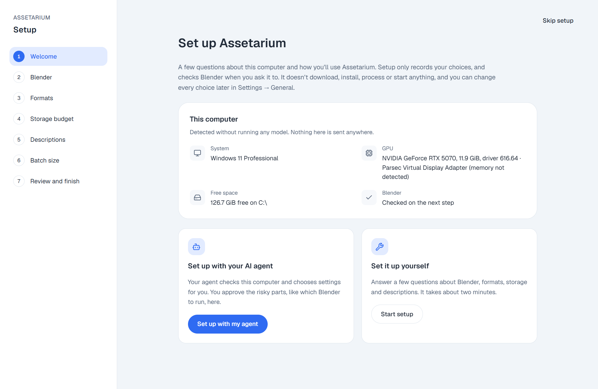
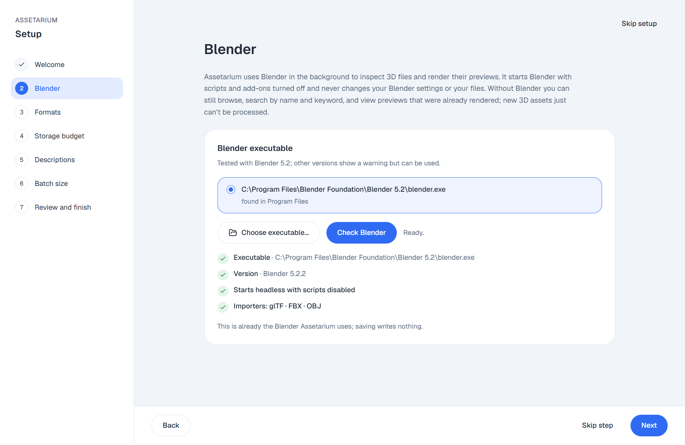
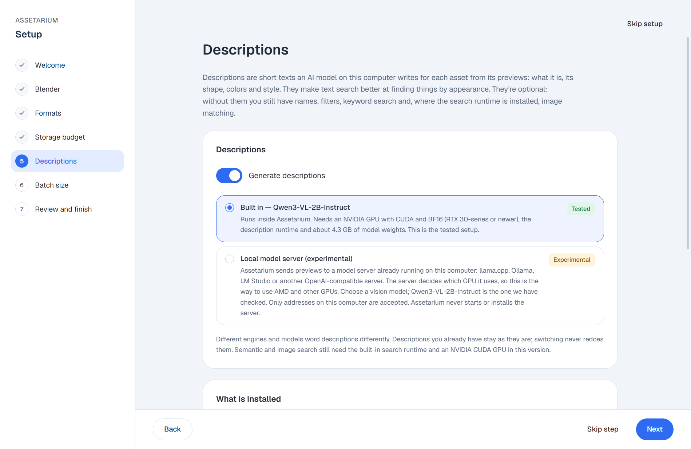
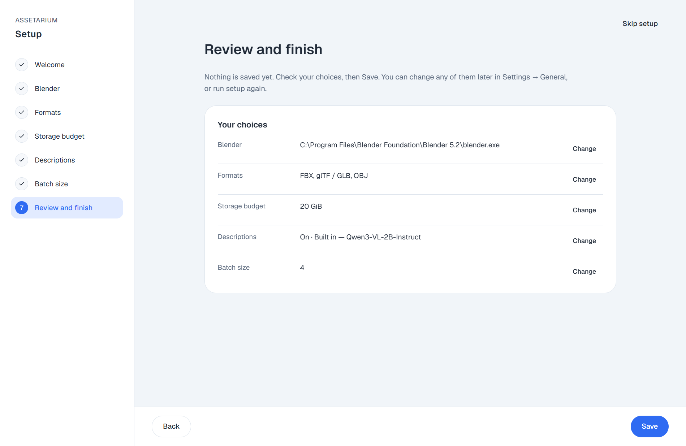

# Assetarium

**Find the right asset in the packs you already own.**

Assetarium is a free, local asset library for indie game developers and hobbyists. Point it
at the folders where your 3D models and 2D art live — Kenney kits, Quaternius packs, Synty
bundles, itch.io downloads, your own exports — and it builds a searchable catalog with
previews, a 3D viewer and AI-written descriptions. Everything runs on your computer, and
your original files are never changed.

Version **0.1.0** · Windows desktop app · Linux command line · [AGPL-3.0](LICENSE)

## Why Assetarium

If you make games on your own or in a small team, you probably have the same problem:
thousands of assets spread across dozens of packs, each with its own folder layout and
naming scheme. Finding "a wooden crate", "a low-poly pine tree" or "a red potion icon"
means opening folders one by one, or importing whole packs into your engine just to look.

Assetarium fixes that:

- **One place for every pack.** Add as many folders as you like; Assetarium scans them
  and keeps the catalog up to date when packs change.
- **See before you import.** Every 3D model gets rendered previews and can be rotated in
  a built-in 3D viewer. Images get thumbnails, including SVGs.
- **Search the way you think.** Search by file name, by what an asset looks like ("mossy
  stone wall"), by an image, or by all of them at once.
- **Know what you're getting.** Triangle counts, formats, textures and other files an
  asset depends on, so nothing is missing when you bring it into your engine.
- **Stay organized.** Group assets into collections for a level or a prototype, tag them,
  and export a collection as JSON, Markdown, a PNG sample sheet or a printable report.
- **Let your AI assistant help.** Agents like Claude Code and Codex can search your library
  and pick assets for you through a built-in MCP server.
- **Private and offline.** No account, no cloud, no uploads. AI models run locally on
  your own GPU, and your asset files are only ever read.

## What it supports

| | |
| --- | --- |
| **3D models** | FBX, glTF/GLB and OBJ are inspected, previewed and searchable; BLEND, DAE and STL files are listed in the catalog |
| **2D images** | PNG, JPEG, WebP, GIF, BMP, TGA, TIFF, AVIF and SVG |
| **Search** | File name and keyword, description, image similarity, and a combined mode |
| **Platforms** | Windows 10/11 (desktop app, command line, MCP); Linux x86_64 (command line and MCP) |

## Requirements

**Needed:**

- Windows 10 or 11 (or Linux x86_64 with glibc 2.35 or newer for the command line)
- [Git](https://git-scm.com/) and [uv](https://docs.astral.sh/uv/) on your `PATH`
- [Blender](https://www.blender.org/) to inspect 3D files and render previews (tested with 5.2)
- Microsoft Edge WebView2 Runtime (included with Windows 11)

**Optional, for AI descriptions and appearance search:**

- An NVIDIA GPU with CUDA and BF16 support (RTX 30-series or newer) for the built-in engines
- About 6 GB for the local models (Qwen3-VL-2B for descriptions, EmbeddingGemma for search)
  plus a few GB for their runtimes

Without a GPU you can still browse, preview, view in 3D and search by name. Appearance and
image search can also run on the CPU (slower to index, same results). Other GPUs can write
descriptions through a local model server such as llama.cpp, Ollama or LM Studio
(experimental).

## Getting started

### 1. Download and install

```powershell
git clone https://github.com/brunodalarosa/assetarium.git
cd assetarium
.\scripts\uv.ps1 sync --locked
.\scripts\mcp-runtime.ps1 sync --locked --project runtime/mcp
```

This installs the app's Python environments inside the project folder. Nothing is
installed system-wide.

### 2. Open Assetarium

Double-click **`Local Asset Library.vbs`** in the project folder. The first time, a short
setup guides you through a few choices. Setup only records your choices — it never
downloads, installs or processes anything on its own — and you can change everything later
in **Settings → General**.

<p align="center">
  <picture>
    <source media="(prefers-color-scheme: dark)" srcset="docs/images/setup/00-welcome-dark.png">
    
  </picture>
</p>

**Choose how to set up.** Pick **Set up with my agent** and your AI agent checks this
computer and chooses the settings for you, while you approve the risky parts, like which
Blender to run. Or pick **Start setup** and answer a few questions yourself; it takes
about two minutes. The steps below follow the second path.

**Blender.** Assetarium finds your Blender installation and checks that it can import
glTF, FBX and OBJ. Blender always runs in the background with scripts and add-ons turned
off.

<p align="center">
  <picture>
    <source media="(prefers-color-scheme: dark)" srcset="docs/images/setup/01-blender-ready-dark.png">
    
  </picture>
</p>

**Formats, storage and descriptions.** Choose which 3D formats to process, how much disk
space Assetarium may use, and whether to generate AI descriptions — with the built-in
model on an NVIDIA GPU, or a local model server for other GPUs.

<p align="center">
  <picture>
    <source media="(prefers-color-scheme: dark)" srcset="docs/images/setup/04-descriptions-builtin-dark.png">
    
  </picture>
</p>

**Review and save.** Check your choices and save.

<p align="center">
  <picture>
    <source media="(prefers-color-scheme: dark)" srcset="docs/images/setup/06-review-dark.png">
    
  </picture>
</p>

You can also run the same setup from a terminal with `.\scripts\local-assets.ps1 setup`,
or let your AI agent do it (see [Use with AI agents](#use-with-ai-agents)).

### 3. Add your asset folders

Go to **Settings → Asset sources** and add the folders that hold your packs. Assetarium
scans them right away; scanning only reads file information and never runs Blender or AI
models.

### 4. Process your assets

Open **Asset processing** and click **Process assets** on a source. Assetarium renders
previews in Blender and makes the assets searchable. Processing only starts when you ask
for it, shows its progress, and can be cancelled. If a file can't be processed, it's
listed with the reason and everything else keeps working.

### 5. Optional: turn on AI descriptions and appearance search

The setup's **Descriptions** step shows what's missing on your computer and the exact
command to install each piece. With the built-in engine that is:

```powershell
.\scripts\caption-runtime.ps1 sync --locked --project runtime/caption
.\scripts\caption-runtime.ps1 run --locked --no-sync --project runtime/caption python scripts/prepare_caption_model.py
.\scripts\embedding-runtime.ps1 sync --locked --project runtime/embedding
.\scripts\embedding-runtime.ps1 run --locked --no-sync --project runtime/embedding python scripts/prepare_embedding_model.py
```

Then use **Generate descriptions** on a source. Descriptions are optional: names, keyword
search, previews and the 3D viewer work without them. More on engines in
[Description engines](docs/description-engines.md).

### Prefer the command line?

Setup, sources, processing, descriptions and collection exports also work from a terminal,
on Windows and Linux (use `./scripts/local-assets.sh` there):

```powershell
.\scripts\local-assets.ps1 sources add D:\Assets\Kenney
.\scripts\local-assets.ps1 process --asset-source <key>
.\scripts\local-assets.ps1 setup status
```

See the [command line guide](docs/cli.md) and [Linux setup](docs/linux.md).

## Use with AI agents

Assetarium includes a local MCP server, so coding agents can search your library while
they build your game: "find me three low-poly trees in a similar style" returns real files
from your packs, with previews and the paths to import.

To connect an agent, open the app's **Set up with your AI agent** panel and copy the
ready-made snippet for Claude Code, Codex, OpenCode or another MCP client. Your agent can
then:

- **search** your library and look at previews and asset details,
- **organize** assets into collections and add tags,
- **help with setup**, proposing settings that you approve in the app.

The server runs only while your agent is connected, listens only on your computer, and can
never change or delete your asset files. Details: [MCP tools](docs/mcp/README.md) and the
[asset-selection skill](skills/local-asset-library/SKILL.md).

## Your files are safe

- Original assets are **only ever read**. Previews, descriptions and search data go to a
  `metadata-lal` folder next to each source and to the project's `data` folder.
- Nothing runs in the background without you: no automatic processing, no model loading
  at startup, no network access for your library.
- Faults are recorded and shown, never hidden or silently retried.
- Assetarium catalogs the assets you bring; it doesn't include asset packs or model
  weights. Check each pack's license before using its assets in a game — AI descriptions
  help you find things but don't confirm what an asset is allowed to be used for.

## Documentation

- [Desktop app guide](docs/gui/README.md) · [3D viewer](docs/gui/3d-preview.md)
- [Asset sources and processing](docs/asset-sources.md) · [Library updates](docs/library-updates.md)
- [Command line](docs/cli.md) · [Linux](docs/linux.md)
- [Description engines](docs/description-engines.md) · [Model storage](docs/model-storage.md)
- [MCP server](docs/mcp/README.md)
- [Storage use](docs/storage.md)
- [Current status and roadmap](docs/status.md)

## Contributing

Bug reports, ideas and pull requests are welcome on
[GitHub](https://github.com/brunodalarosa/assetarium). When reporting a problem, include
what you expected, what happened, the asset format and your operating system. Please use
small test files instead of uploading paid asset packs.

Before changing code, read [AGENTS.md](AGENTS.md) and the
[design decisions](docs/decisions/README.md): they describe how the project protects
original files, handles faults and manages disk space. Run the tests with:

```powershell
.\scripts\mcp-runtime.ps1 run --locked --no-sync --offline --project runtime/mcp python -m pytest --basetemp scratch/pytest
```

Contributions are accepted under a Contributor License Agreement.

## License

Assetarium is free software under the [GNU Affero General Public License v3.0](LICENSE).
Bundled third-party components keep their own licenses
([viewer and vendored files](src/local_asset_library/ui/vendor/README.md)). Asset packs and
AI model weights are not part of Assetarium and have their own terms.
